# 数据挖掘技术与应用结课报告

## 融合多波段观测数据的星系分类网络

组号：待填　　小组成员：待填　　日期：2026年11月16日

## 摘要

本项目将 SDSS×CatWISE 结构化交叉匹配星表与 Pan-STARRS 五波段图像文件元数据关联，得到 1,314,678 条有效记录和 59 个字段，完成数据治理、分类比较、聚类、关联规则和解释分析。分类器输入为 14 个 CatWISE 测光量及 W1−W2 颜色；图像元数据用于来源追溯和文件质量筛选，未进入预测器。采用固定外层分层 5 折，每个训练折内独立开展 3 折超参数搜索。RF 的 Macro-F1 为 0.8171±0.0005。聚类取 k=4，有放回 bootstrap 的 OOB ARI 为 0.9929±0.0035。关联规则经约束和去冗余后保留 14 条。报告包含 13 幅图、6 个错误案例、3 个留出样本的局部 SHAP 解释，以及可运行的 Notebook。

## 一、选题与组内任务分配

### 1.1 选题背景与任务边界

巡天星表中，星系、类星体和恒星在颜色、亮度、信噪比等测光特征上存在重叠。本项目建立三分类表格基线，识别容易混淆的样本群，并形成候选筛选规则与复核建议。选题属于天文数据分析，课程模板允许自主选题，具有明确的研究用途。

项目名称中的“网络”指数据获取、治理和分析组成的流程。本轮使用本机表格模型，不是端到端图像网络，未使用图像像素或形态特征；不声称验证了多模态融合增益。原始图像留在服务器，已有文件快照在本机复用。

### 1.2 组内任务分配

| 组号 | 成员 | 实际负责内容 | 任务贡献% |
|---|---|---|---|
| 待填 | 成员一待填 | 据实际完成情况填写 | 待填 |
| 待填 | 成员二待填 | 据实际完成情况填写 | 待填 |
| 待填 | 成员三待填 | 据实际完成情况填写 | 待填 |
| 总计 |  |  | 应为100% |

## 二、需求分析

### 2.1 目标与验收标准

目标一是建立可追溯的异构融合表；目标二是以统一的源级划分比较分类方法，重点观察少数类 STAR；目标三是给出可解释的分群、规则及错例，支持后续观测复核。技术验收依据课程模板表1，团队事实按实际记录补入。

| 模板要求 | 本项目对应证据 |
|---|---|
| 至少2类异构来源及百万记录 | 结构化星表＋独立FITS文件元数据；1,314,678条、59字段 |
| 缺失≥3策略、异常≥2方法、一致性 | 删除/中位数/迭代填补；3σ/IQR；处理前后统计 |
| 基线加≥3模型、分层5折、搜索与检验 | LR基线＋NB/RF/HGB；训练折内3折搜索；McNemar等 |
| 聚类选k、bootstrap ARI≥0.6 | 肘部/轮廓系数；10次有放回重采样及OOB评估 |
| 关联规则、效率、阈值、≥5条解读 | Apriori与FP-Growth；9组含提升度变化的组合；14条规则 |
| 分群误差、≥5错例、≥3局部解释 | 类别/亮度/SNR/颜色/赤纬切片；6错例；3个局部SHAP |
| ≥8图、Notebook、源码及日志 | 13幅图；3种本地运行模式；固定依赖和执行日志 |

### 2.2 数据与计算可行性

原始星表实测 3,944,564 行、24 字段，文件头中的 4,253,435 不是实际行数。图像元数据来自 395 个分区的真实 FITS 文件清单、文件属性及部分主头，属于独立的半结构化来源，并非将星表转为 JSON 充数。融合表约 338 MB，可在本机 10 核 CPU、16 GB 内存上分析。分类使用 4 个工作线程，聚类为 20 万抽样，关联规则为 15 万抽样；不把抽样分析写成全量训练。

图像完整性与像素质量须区分：已有 150,000 源的 750,000 图文件清单完整；300 源/1,500 图像素抽检中有 21 图含非有限像素。百万级像素内容验收未执行，不属于本轮表格分类结果。

## 三、设计思路与实现方法

### 3.1 获取与融合流程

原始星表和元数据快照 → 固定哈希选源 → source_id 一对一关联 → 完整性验收与数据字典 → 固定分层五折 → 治理对照与分类 → 聚类、规则 → 误差与 SHAP → 图表、报告和 Notebook。

| 阶段 | 记录数或字段数 |
|---|---|
| 原星表实际行数 | 3,944,564 |
| 固定 BLAKE2b(source_id) 模3为0的候选 | 1,315,321 |
| 文件缺失或重复而拒绝 | 643 |
| 最终有效独立source_id | 1,314,678 |
| 主表字段 | 59 |
| 完整r头／仅文件属性 | 9,968／1,304,710 |

通过固定哈希遍历所有分区，不按模型预测筛选数据；五个波段不重复计为五条样本。元数据与星表在 source_id 上 1:1 内连接，并检查切图中心与 SDSS 位置偏移≤3角秒。字典记录全部59字段的名称、含义、类型、单位、范围、缺失率、来源与时点；原始快照、采集脚本、分区清单及拒绝记录均保留。采集区间为2026年11月11日02:26:55—02:45:59 UTC，历史星表导出时点另行保留，不等同于观测时刻。

### 3.2 固定划分与防泄漏

固定种子20261112，按class_01分层、按source_id划分。五折大小依次为262,937、262,936、262,936、262,935、262,934；类别比例最大偏差2.66×10⁻⁶。同源多波段始终在同一条记录内。填补、截尾、标准化和类别权重只在训练折估计。

本次修订将超参数搜索移到每个外层训练折内部：从约105万外层训练源中分层抽取30,000源做内层3折网格搜索，再以所选配置在完整外层训练折重训并预测约26万留出源。每个外层折的内层样本与其验证集交集为0，5折均产生OOF概率。检查点绑定主表哈希、折文件哈希、代码哈希、依赖版本和调参样本规模；输入变化不会误用旧预测缓存。

source_id、类别、路径、采集时间、文件mtime及头校验值均不作为预测特征。坐标只用于诊断。划分未按天区分块，近邻源和观测选择可能相关；本次属于已查看过数据后的修订实验，没有新的独立测试集，不能据此宣称完全无偏的外部泛化能力。

### 3.3 数据治理

原星表24字段未检出显式缺失，不能据此判定真实MCAR/MAR/MNAR机制。缺失实验是受控模拟：MCAR随机遮蔽W1或W2整组7特征；MAR按可见W1信噪比训练分位数遮蔽W2；MNAR按将被隐藏的W2星等训练分位数遮蔽W2。各机制设置5%/10%/20%缺失率，三策略共享掩码，比较删除、中位数和IterativeImputer(LinearRegression,max_iter=3)，统一下游LR。

原始尺度不同，重构误差逐字段保留原单位，跨字段汇总使用训练标准差归一化。删除法只在完整子集评估，因此另报覆盖率，并保存共同完整验证子集上的对照分数。缺失模拟中的重构指标不构成独立回归任务；本项目没有时序预测任务。

异常筛选比较3σ与IQR，阈值来自训练折。真实亮源、暗源和巡天选择尾部可能呈重尾，不因异常标记直接删除源；以训练折1%/99%分位数截尾修正极端输入。类型、编码、单位、重复键、范围、时区和关联基数在一致性环节独立检查。

### 3.4 特征与分类方法

输入为W1/W2各7个测光量（背景、背景误差、SNR、通量、通量误差、星等、星等误差）加W1−W2颜色，共15个特征。只新增一个领域颜色特征；模板中的不平衡专项与“8个衍生特征＋时间窗”均为可选项，本项目不申报这两项。单历元资料不应伪造时间窗特征。

LR提供线性基线；NB检验条件独立近似；RF建模非线性并可解释；HGB以提升树作另一集成对照。搜索空间：LR的C∈{0.1,1,10}和类别权重；NB的var_smoothing∈{1e−9,1e−7,1e−5}和先验；RF的max_depth∈{None,30}、叶最小样本∈{1,5}和类别权重；HGB的learning_rate∈{0.05,0.1}、叶节点数∈{31,63}和类别权重。RF最终100棵树，HGB最终最多120轮并使用训练折内早停验证。LR/NB另外标准化。

评价使用Accuracy、Macro-F1、Macro PR-AUC（以average precision定义）与Log loss，汇报五折均值及样本标准差。OOF配对预测作McNemar，折级Macro-F1作Friedman与Nemenyi。McNemar判断正确/错误率差异，不能把其显著性解释为Macro-F1或某个模型在所有指标上都更好；折间训练样本重叠，统计检验为探索性证据。

### 3.5 聚类与关联规则

K-means在20万分层抽样源、15个截尾并标准化特征上拟合，不把类别输入聚类器。k=2至10同时计算肘部与轮廓系数，取舍结合簇画像。10次有放回抽取20万行，各次重新拟合K-means，在未抽中的唯一OOB源上预测并与参考聚类比较ARI；预处理固定，因此报告的是给定表示下的聚类稳定性。

关联规则使用15万分层抽样，每源4个项：颜色、星等、SNR与类别。颜色分箱为≤0.05、(0.05,0.5]、>0.5 mag；W1为≤15、(15,16]、>16 mag；SNR为≤25、(25,50]、>50。Apriori与FP-Growth在同一矩阵上对比时间，并逐项校验项集及支持度一致。主阈值为support≥0.05、confidence≥0.7、lift>1.1。只保留后项为单个类别、前项不含类别的可行动规则，去除空项、重复和同后项下不提高置信度的更具体前项。

### 3.6 解释与工程实现

按真实类别、W1亮度、SNR、颜色、赤纬切片统计误差；从各类错误中按置信度、source_id确定性选2例，共6例，原因作为待验证假设。SHAP使用保存的第0折RF原模型及原截尾边界，选择第0折中每个已有类别按source_id排序的首个样本作局部解释，再加100个固定随机留出样本汇总全局重要性。样本不按预测成败挑选。校验SHAP基值＋贡献和等于类别概率，也校验模型概率与原OOF概率相同。

代码按data、src、notebooks、results、docs组织。requirements.txt固定实际分析环境版本；Python 3.13.7。断言覆盖百万行/字段、唯一键、5折完整、内外层无交集、概率归一化、项集等价、ARI门槛和SHAP加和。执行日志保留阶段耗时、硬件和命令；Notebook可验证现有结果、重算分析或从本地原始快照重建，全程不调用远程采集。

## 四、结果展示和关键代码分析

### 4.1 数据分布与治理结果

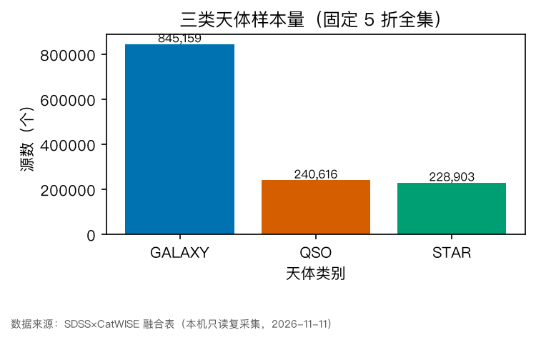

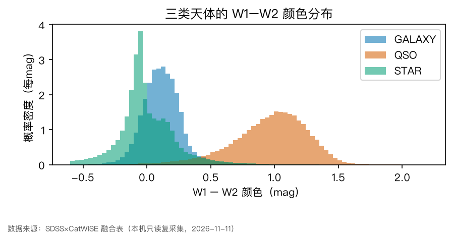

GALAXY 845,159源（64.29%），QSO 240,616（18.30%），STAR 228,903（17.41%）。少数类表现需结合Macro-F1、PR-AUC和各类召回评估。

| 机制与比例 | 删除F1 | 删除覆盖率 | 中位数F1 | 迭代F1 |
|---|---|---|---|---|
| MCAR 5% | 0.7268 | 95% | 0.6907 | 0.7110 |
| MCAR 10% | 0.7268 | 90% | 0.6657 | 0.6960 |
| MCAR 20% | 0.7274 | 80% | 0.6189 | 0.6692 |
| MAR 20% | 0.7379 | 80% | 0.6144 | 0.6467 |
| MNAR 20% | 0.7631 | 80% | 0.5565 | 0.5523 |

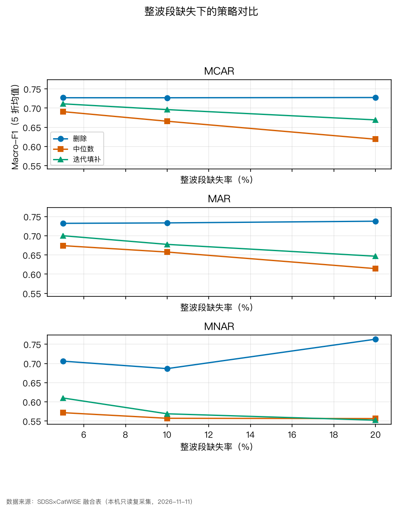

删除法在MCAR下约0.727，但覆盖率随缺失率降至80%；MAR/MNAR下完整子集存在选择偏差，不能直接把删除法分数与全量填补分数当作同一任务比较。迭代填补在9组场景中的8组优于中位数，但MNAR 20%时中位数0.5565略高于迭代0.5523，因此不能写成“始终最差”或“所有机制最优”。若以MCAR且要求近全覆盖为参考，采用迭代填补；真实缺失机制改变时应重新验证。本轮主分类测光量无缺失，无需实际填补。

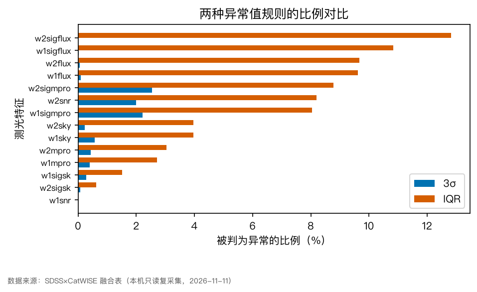

IQR把约9.6%—12.8%的通量记录标为异常，3σ较少。LR探针对照从Macro-F1 0.7271提高至0.7490，五折差值均值+0.0220、标准差0.0005；据此保留全部源并做训练折截尾。该治理选择来自同份数据的探索，结果不等同于新外部测试上的增益。

| 一致性项目 | 处理前 | 处理后 |
|---|---|---|
| 有效行数 | 1,314,678 | 1,314,678 |
| 重复source_id | 0 | 0 |
| 星表数值缺失单元格 | 0 | 0 |
| 非法标签/坐标/关联偏移 | 0 | 0 |
| 折号关联缺失 | 0 | 0 |
| 时间表示 | UTC ISO8601 | 保持UTC，无需换算 |

r_mjd_obs只覆盖9,968源（0.758%）。其余头字段是未采集，不是观测自然缺失；FITS的BUNIT未提供处保留未知，单位字典一致不代表未知单位已被实测确认。

### 4.2 分类比较与统计检验

| 模型 | Accuracy | Macro-F1 | Macro PR-AUC | STAR召回 |
|---|---|---|---|---|
| LR | 0.7692±0.0012 | 0.7595±0.0011 | 0.8180±0.0009 | 0.776 |
| NB | 0.7791±0.0008 | 0.7204±0.0012 | 0.7673±0.0013 | 0.463 |
| RF | 0.8520±0.0006 | 0.8171±0.0005 | 0.8820±0.0005 | 0.671 |
| HGB | 0.8643±0.0006 | 0.8152±0.0007 | 0.8861±0.0005 | 0.544 |

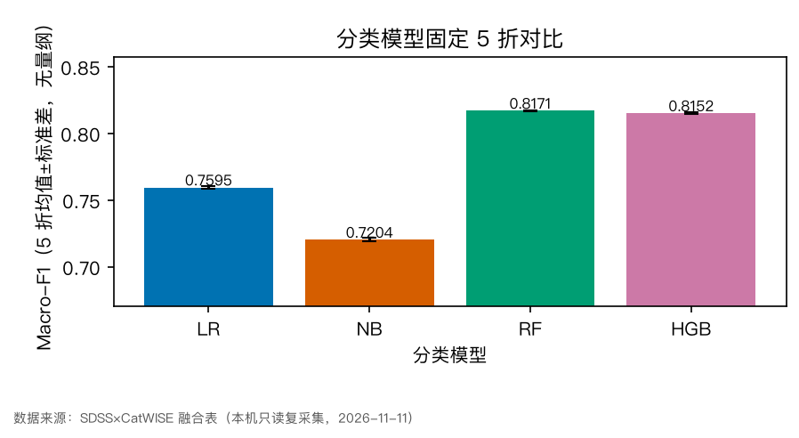

按OOF Macro-F1选择RF，其错误率为14.80%。这不是独立测试结果；各模型调参使用的30,000源开发子集随外层折变化，最终模型在完整训练折拟合，所有配置见results/classification/model_comparison.json中的outer_tuning。

| 配对比较 | 前者错/后者对 | 前者对/后者错 | McNemar统计量 | p值 |
|---|---|---|---|---|
| RF / LR | 41215 | 150158 | 62016.896 | <1e−300 |
| RF / NB | 40201 | 136036 | 52112.528 | <1e−300 |
| RF / HGB | 51166 | 35006 | 3030.141 | <1e−300 |

Friedman统计量15.000，p=0.0018166；Nemenyi临界差2.098。显著秩差对：NB–RF。大样本下很小的p值不等于效果很大，应结合指标差、类别召回和相关性限制判断。

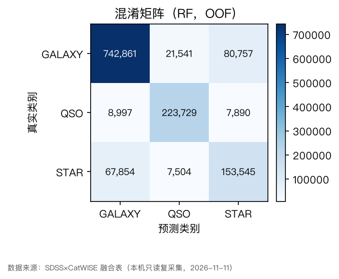

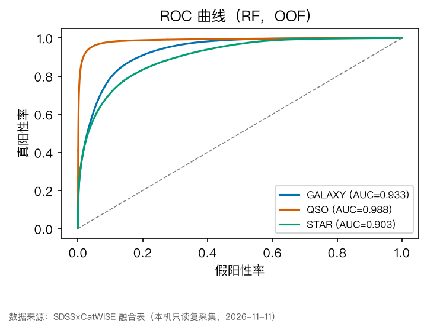

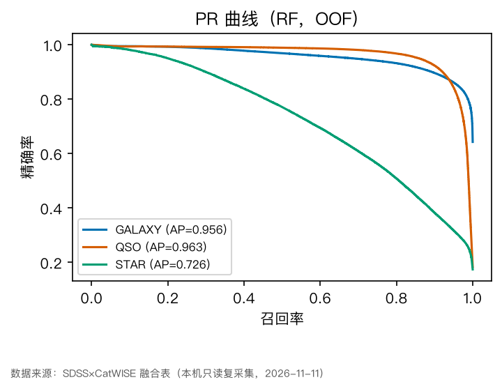

### 4.3 分群误差与典型错例

| 分群维度 | 分组 | 源数 | 错误率 | Macro-F1 |
|---|---|---|---|---|
| W1亮度 | ≤15 mag | 362,843 | 8.69% | 0.8735 |
| W1亮度 | 15–16 mag | 553,017 | 10.96% | 0.7485 |
| W1亮度 | >16 mag | 398,818 | 25.68% | 0.6974 |
| W1信噪比 | ≤25 | 352,552 | 16.98% | 0.8069 |
| W1信噪比 | 25–50 | 473,496 | 15.68% | 0.7957 |
| W1信噪比 | >50 | 488,630 | 12.37% | 0.8425 |

类别、颜色及赤纬的全部切片保存在results/evaluation/error_slices.csv。切片支持定位薄弱观测条件，分组样本组成不同，不能仅凭错误率推断信噪比或天区的因果影响。以下六个源保留标识，便于回到星表核查：

案例1：source_id=0060p015_b0-034957，已有标签GALAXY→预测QSO，最大类概率1.0000；W1−W2=1.046 mag，W1=17.42 mag，SNR=14.6。红端颜色与QSO候选区域重叠；需用光谱或形态复核，不能仅据测光认定标签错误。

案例2：source_id=0090p030_b0-011218，已有标签GALAXY→预测QSO，最大类概率1.0000；W1−W2=1.106 mag，W1=16.45 mag，SNR=29.8。红端颜色与QSO候选区域重叠；需用光谱或形态复核，不能仅据测光认定标签错误。

案例3：source_id=0224p196_b0-003836，已有标签QSO→预测GALAXY，最大类概率1.0000；W1−W2=0.115 mag，W1=15.39 mag，SNR=12.8。蓝端或中间色的星系与恒星测光重叠；亮度、SNR和形态可能影响判别，尚未验证物理成因。

案例4：source_id=0305m076_b0-003147，已有标签QSO→预测GALAXY，最大类概率1.0000；W1−W2=0.239 mag，W1=13.85 mag，SNR=51.1。蓝端或中间色的星系与恒星测光重叠；亮度、SNR和形态可能影响判别，尚未验证物理成因。

案例5：source_id=0034p302_b0-020655，已有标签STAR→预测QSO，最大类概率1.0000；W1−W2=1.085 mag，W1=16.90 mag，SNR=23.1。红端颜色与QSO候选区域重叠；需用光谱或形态复核，不能仅据测光认定标签错误。

案例6：source_id=0036p348_b0-005976，已有标签STAR→预测GALAXY，最大类概率1.0000；W1−W2=0.139 mag，W1=15.18 mag，SNR=23.6。蓝端或中间色的星系与恒星测光重叠；亮度、SNR和形态可能影响判别，尚未验证物理成因。

高模型概率不是物理可靠度；这些案例尚未做独立光谱/图像标签复审，不能直接归因于标签错误或已确认的物理机制。

### 4.4 全局和局部解释

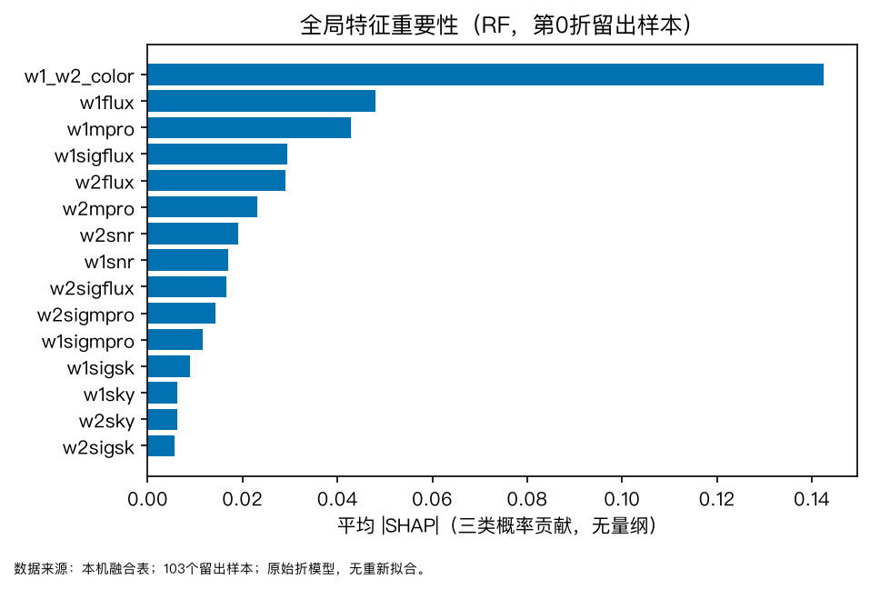

全局平均绝对贡献前三项为w1_w2_color、w1flux、w1mpro；统计基于103个第0折留出样本，用于描述该RF模型的局部总体趋势，不是131万源的全量SHAP普查。相关特征之间会分摊贡献，重要性不等于因果效应。

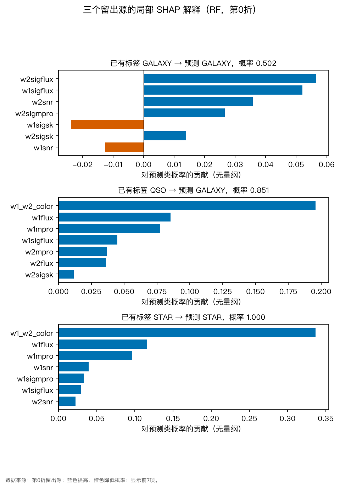

局部样本1：source_id=0000m016_b0-000330，已有标签GALAXY，预测GALAXY。预测类基值0.3333＋全部特征贡献+0.1690＝预测概率0.5023。绝对贡献前三：w2sigflux=88.5，贡献+0.0565；w1sigflux=127，贡献+0.0521；w2snr=126，贡献+0.0358。正贡献提高该预测类概率，负贡献降低；其余项见supplement.json。

局部样本2：source_id=0000m016_b0-002386，已有标签QSO，预测GALAXY。预测类基值0.3333＋全部特征贡献+0.5175＝预测概率0.8509。绝对贡献前三：w1_w2_color=0.333，贡献+0.1956；w1flux=953，贡献+0.0853；w1mpro=15.1，贡献+0.0775。正贡献提高该预测类概率，负贡献降低；其余项见supplement.json。

局部样本3：source_id=0000m016_b0-000994，已有标签STAR，预测STAR。预测类基值0.3333＋全部特征贡献+0.6667＝预测概率1.0000。绝对贡献前三：w1_w2_color=-0.082，贡献+0.3365；w1flux=2.8e+03，贡献+0.1161；w1mpro=13.9，贡献+0.0966。正贡献提高该预测类概率，负贡献降低；其余项见supplement.json。

三个源都在留出折，第0折模型未用其标签训练；解释概率与原OOF概率一致，加和误差小于10⁻⁵。SHAP只解释模型为何给出该预测，不证明预测在物理上正确。

### 4.5 聚类结果

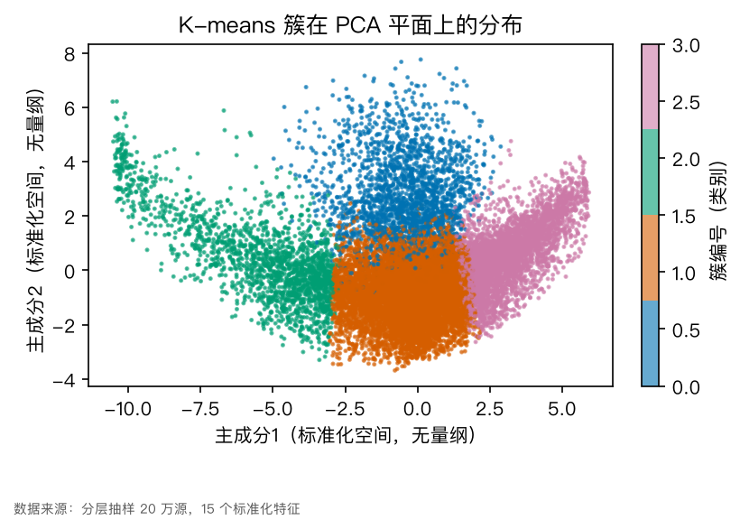

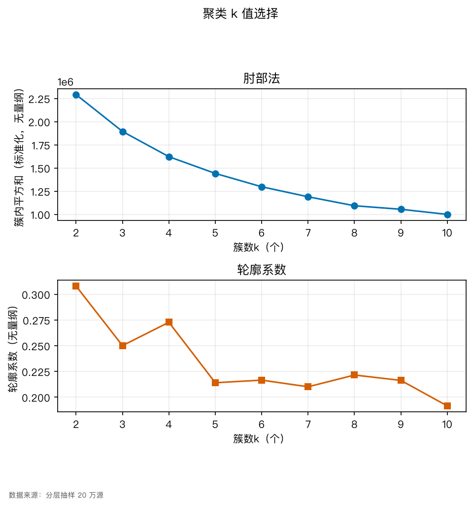

肘部法给k=5，轮廓系数最高在k=2（0.3080）。选k=4（轮廓0.2728）是保留亮度/颜色/SNR细分画像的解释性折中，非两指标共同最优。10次有放回重采样OOB ARI=0.9929±0.0035，超过0.6；这验证给定预处理下稳定性，不替代科学有效性。

| 簇 | 规模 | 星系/QSO/恒星% | 颜色中位 | W1均值 | 命名 |
|---|---|---|---|---|---|
| 0 | 21,813 | 97.9/1.2/1.0 | 0.19 | 14.94 | 低信噪比星系富集群 |
| 1 | 118,430 | 70.7/14.2/15.1 | 0.10 | 15.46 | 主体混合群 |
| 2 | 19,420 | 67.8/9.8/22.5 | 0.12 | 13.47 | 明亮高信噪比群 |
| 3 | 40,337 | 25.5/43.8/30.6 | 0.43 | 17.23 | 暗弱红端混合群 |

颜色与星等单位均为mag。簇0优先用于星系候选复核；簇1作为主体混合样本使用分类器；簇2适合优先人工复核和观测跟进；簇3优先补充光谱、形态或变光资料。原始簇命名中的“主序”缺乏恒星主序证据，修订为“主体混合群”。

### 4.6 关联规则与用途

Apriori耗时0.03s，FP-Growth 0.26s，均得到84个频繁项集，项集和支持度逐项一致。当前只有12项、每事务4项，树构建开销可能主导，不能外推算法优劣。

| 支持度下限 | 置信度下限 | 提升度严格下限 | 规则数 |
|---|---|---|---|
| 0.02 | 0.5 | 1.0 | 149 |
| 0.02 | 0.7 | 1.1 | 78 |
| 0.02 | 0.8 | 1.5 | 40 |
| 0.05 | 0.5 | 1.0 | 95 |
| 0.05 | 0.7 | 1.1 | 52 |
| 0.05 | 0.8 | 1.5 | 21 |
| 0.1 | 0.5 | 1.0 | 53 |
| 0.1 | 0.7 | 1.1 | 24 |
| 0.1 | 0.8 | 1.5 | 5 |

上述9组组合同时覆盖支持度、置信度和提升度变化，用于整体阈值敏感性比较；其中置信度与提升度成对变化，不能据此单独归因于某个阈值。

主阈值下原始52条，限制可行动方向后24条，去冗余后14条。以下5条的前项均不含类别：

规则1：W1 信噪比中（25–50） + W1 暗源（>16 mag） + W1−W2 红端（>0.5） → 类星体；支持度0.050、置信度0.949、提升度5.19。中等SNR下再要求暗弱且偏红，可组成较严格的QSO优先复核池；与规则2比较条件增加后的置信度和支持度折中。

规则2：W1 信噪比中（25–50） + W1−W2 红端（>0.5） → 类星体；支持度0.066、置信度0.938、提升度5.12。中等SNR的红源不限制亮度，适合较宽的QSO预选入口；其支持度大于规则1，条件更少，需接受更低的置信度。

规则3：W1 暗源（>16 mag） + W1−W2 红端（>0.5） → 类星体；支持度0.124、置信度0.891、提升度4.87。暗弱加红端只需两个测光条件，便于批量初筛；适合将候选交给后续光谱或形态复核，不保证外部巡天精确率。

规则4：W1−W2 红端（>0.5） → 类星体；支持度0.170、置信度0.887、提升度4.85。只用颜色即可建立粗筛队列，比多条件规则易实施；复杂规则并非一定必要，应比较筛选成本、覆盖和误报。

规则5：W1 中等亮度（15–16 mag） + W1 信噪比低（<25） → 星系；支持度0.064、置信度0.976、提升度1.52。中等亮度低SNR的样本在本抽样中星系富集，可将该队列优先安排更深成像或星系候选复核；低SNR不等同于数据无效。

规则只在15万抽样事务上挖掘，未在独立样本验证，属于描述性候选筛选依据，不能替代分类模型或作为因果规律。

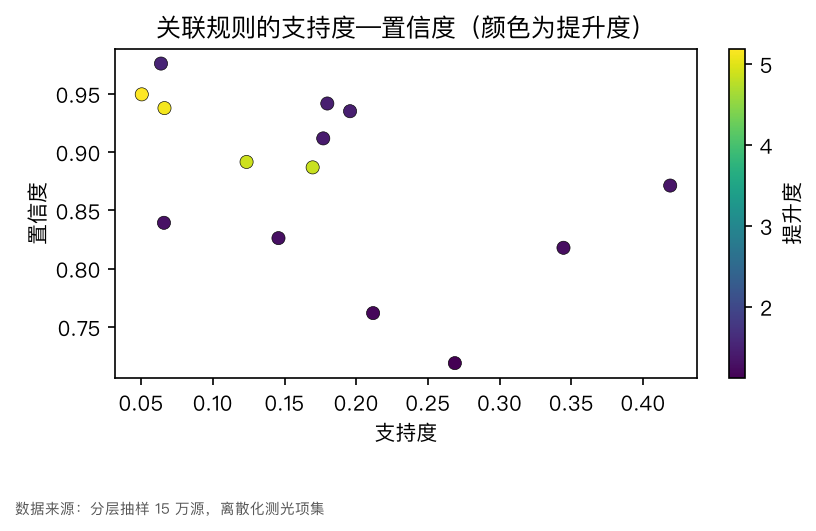

### 4.7 关键代码与分析

源级分层划分使用NumPy按类别取索引和随机置换，再均匀分配折号，保证一源一折：

```python
rng = np.random.default_rng(config.SEED)
for cls in sorted(np.unique(labels)):
    idx = np.flatnonzero(labels == cls)
    order = idx[rng.permutation(len(idx))]
    fold[order] = np.arange(len(order)) % 5
```

异构融合使用pandas的一对一校验，额外断言防止多对多关联将行数膨胀：

```python
joined = catalog.loc[frame.index].join(
    frame, how="inner", validate="one_to_one")
assert len(joined) == valid
```

每个外层训练折单独抽取内层样本，搜索函数内部重新拟合截尾和标准化。内外层无交集断言保护最终验证源：

```python
tr_idx = np.flatnonzero(fold != k)
va_idx = np.flatnonzero(fold == k)
chosen, _ = train_test_split(
    tr_idx, train_size=30000, stratify=y[tr_idx],
    random_state=config.SEED + int(k))
assert not np.intersect1d(chosen, va_idx).size
best, all_results = tune_model(name, X[chosen], y[chosen])
```

有放回重采样会包含重复源，稳定性评价仅在未抽中的唯一OOB源上计一次，避免重复源使ARI虚高：

```python
idx = rng.choice(n, size=n, replace=True)
boot_model = KMeans(n_clusters=k, random_state=seed).fit(X[idx])
oob = np.ones(n, dtype=bool)
oob[np.unique(idx)] = False
ari = adjusted_rand_score(labels[oob], boot_model.predict(X[oob]))
```

### 4.8 运行方式与日志

默认Notebook模式verify会检查融合表、划分和全部交付结果，重新绘图并生成报告Markdown；recompute从本地融合表重做治理、嵌套调参、全部训练和解释；raw先从本地原始星表和395个JSONL快照重建融合表，再执行recompute。完整重跑使用--fresh，忽略旧拟合检查点。

```bash
python -m pip install -r requirements.txt
python src/run_local_pipeline.py --mode verify
# 完整重算，可耗时数十分钟
python src/run_local_pipeline.py --mode recompute
# 从本地原始快照重建并重算
python src/run_local_pipeline.py --mode raw
```

隔离目录已跳过候选Parquet缓存，从原星表和395份JSONL快照重建融合表，耗时175.276秒；重建后的1,314,678行、59字段文件与原表SHA-256完全一致，证明该本地原始重建环节可复现。完整raw模式没有把所有后续分析再重跑一遍。

Notebook为notebooks/星系分类网络_一键重跑.ipynb，运行Jupyter Lab后执行全部单元即可。各次流水线日志在results/runs/日期时间/，记录硬件、依赖、命令、退出码和阶段耗时。报告打印文件的生成使用src/render_course_report.py及documents技能的渲染工具；Notebook的主要复现产物为图表、结果表和Markdown。

本轮分类实际耗时1002.3s，聚类29.2s，规则1.4s，补充解释136.1s；原缺失实验耗时1,523.6s。旧分类汇总中的5.4s仅为缓存汇总时间，不能写作完整训练耗时。修订前版本在results/review_20261116/before中保留。

## 五、团队沟通记录

现有chat目录保存项目用户与助手的技术讨论，可用于追溯技术决策。它不等同于三位组员的真实沟通。本节应由小组依据真实日期、参与者和讨论结论补齐。

| 实际日期 | 参与成员 | 讨论与任务衔接 | 决定和产出 |
|---|---|---|---|
| 待填 | 待填 | 按真实记录填写 | 待填 |
| 待填 | 待填 | 按真实记录填写 | 待填 |

技术决策可追溯记录：11月11日形成数据采集与只读边界；11月12日完成百万级融合验收；11月16日完成分类、聚类、规则和模板复核。以上是项目工作记录，不作为已发生的组员会议证明。

## 六、总结个人贡献与存在问题

### 6.1 个人贡献

| 成员 | 本人完成的具体工作 | 与他人交接内容 | 确认比例 |
|---|---|---|---|
| 成员一待填 | 待填 | 待填 | 待填 |
| 成员二待填 | 待填 | 待填 | 待填 |
| 成员三待填 | 待填 | 待填 | 待填 |

### 6.2 存在问题与改进

真实缺失机制未知，模拟实验不能替代实际缺失评估；可收集有缺失的新数据并以相同覆盖率比较策略。源级随机划分未阻断空间相关，应增加天区分组验证与新独立测试。主模型只使用CatWISE测光，没有证据表明图像元数据提高了分类性能；后续应在授权范围内加入可用形态或像素表征，并做受控消融。

STAR错误较多，需结合成本、召回和概率校准制定复核阈值；不能因总体Accuracy较高就忽略少数类。SHAP全局统计样本较小，可扩大未见源覆盖并检查解释稳定性。关联规则阈值和分箱具有主观性，应另设独立验证集。bootstrap稳定性建立在固定预处理上，可再做重采样中重新估计预处理的敏感性实验。

模板可选的专项不平衡对照及8个衍生特征含时间窗项均未申报；不将其算作必需缺口。组号、三位组员姓名、贡献比例和真实团队沟通仍待实际填写。

## 附录 交付材料索引

数据字典与验收见docs/数据字典_正式版.md、docs/数据获取与融合_验收报告.md；划分见docs/防泄漏与划分说明.md；分类完整结果见results/classification/model_comparison.json、oof_predictions.parquet；局部解释与误差切片见results/evaluation/supplement.json、error_slices.csv；聚类和规则见results/clustering及results/association；13幅图见results/figures；模板对照结论见docs/课程模板符合性检查与补足报告.md。

数据来源依据与字段解释链接保存在数据字典的来源章节，原始查询头保存在docs/历史IRSA查询头.txt。数据文件和代码留在本机课程目录，未向公开服务上传。
