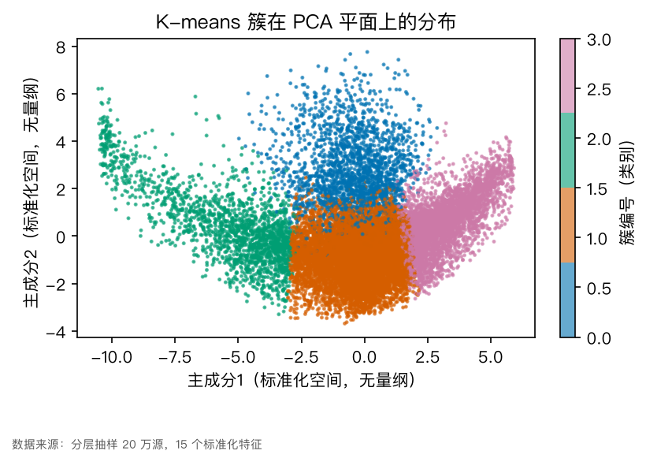
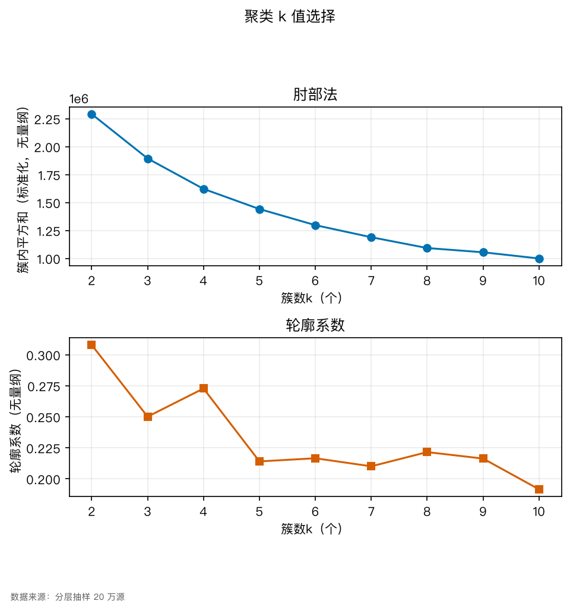
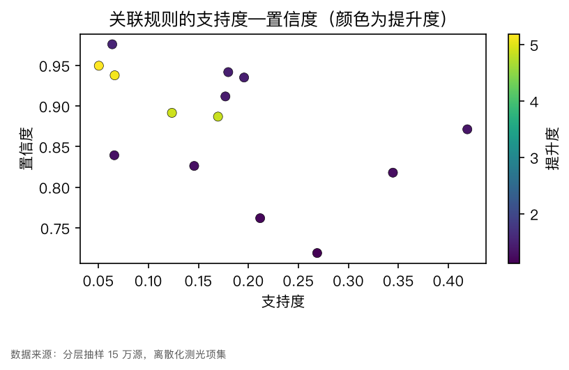

# 聚类与关联规则报告

### 4.5 聚类结果

肘部法给k=5，轮廓系数最高在k=2（0.3080）。选k=4（轮廓0.2728）是保留亮度/颜色/SNR细分画像的解释性折中，非两指标共同最优。10次有放回重采样OOB ARI=0.9929±0.0035，超过0.6；这验证给定预处理下稳定性，不替代科学有效性。

| 簇 | 规模 | 星系/QSO/恒星% | 颜色中位 | W1均值 | 命名 |
|---|---|---|---|---|---|
| 0 | 21,813 | 97.9/1.2/1.0 | 0.19 | 14.94 | 低信噪比星系富集群 |
| 1 | 118,430 | 70.7/14.2/15.1 | 0.10 | 15.46 | 主体混合群 |
| 2 | 19,420 | 67.8/9.8/22.5 | 0.12 | 13.47 | 明亮高信噪比群 |
| 3 | 40,337 | 25.5/43.8/30.6 | 0.43 | 17.23 | 暗弱红端混合群 |

颜色与星等单位均为mag。簇0优先用于星系候选复核；簇1作为主体混合样本使用分类器；簇2适合优先人工复核和观测跟进；簇3优先补充光谱、形态或变光资料。原始簇命名中的“主序”缺乏恒星主序证据，修订为“主体混合群”。

### 4.6 关联规则与用途

Apriori耗时0.03s，FP-Growth 0.26s，均得到84个频繁项集，项集和支持度逐项一致。当前只有12项、每事务4项，树构建开销可能主导，不能外推算法优劣。

| 支持度下限 | 置信度下限 | 提升度严格下限 | 规则数 |
|---|---|---|---|
| 0.02 | 0.5 | 1.0 | 149 |
| 0.02 | 0.7 | 1.1 | 78 |
| 0.02 | 0.8 | 1.5 | 40 |
| 0.05 | 0.5 | 1.0 | 95 |
| 0.05 | 0.7 | 1.1 | 52 |
| 0.05 | 0.8 | 1.5 | 21 |
| 0.1 | 0.5 | 1.0 | 53 |
| 0.1 | 0.7 | 1.1 | 24 |
| 0.1 | 0.8 | 1.5 | 5 |

上述9组组合同时覆盖支持度、置信度和提升度变化，用于整体阈值敏感性比较；其中置信度与提升度成对变化，不能据此单独归因于某个阈值。

主阈值下原始52条，限制可行动方向后24条，去冗余后14条。以下5条的前项均不含类别：

规则1：W1 信噪比中（25–50） + W1 暗源（>16 mag） + W1−W2 红端（>0.5） → 类星体；支持度0.050、置信度0.949、提升度5.19。中等SNR下再要求暗弱且偏红，可组成较严格的QSO优先复核池；与规则2比较条件增加后的置信度和支持度折中。

规则2：W1 信噪比中（25–50） + W1−W2 红端（>0.5） → 类星体；支持度0.066、置信度0.938、提升度5.12。中等SNR的红源不限制亮度，适合较宽的QSO预选入口；其支持度大于规则1，条件更少，需接受更低的置信度。

规则3：W1 暗源（>16 mag） + W1−W2 红端（>0.5） → 类星体；支持度0.124、置信度0.891、提升度4.87。暗弱加红端只需两个测光条件，便于批量初筛；适合将候选交给后续光谱或形态复核，不保证外部巡天精确率。

规则4：W1−W2 红端（>0.5） → 类星体；支持度0.170、置信度0.887、提升度4.85。只用颜色即可建立粗筛队列，比多条件规则易实施；复杂规则并非一定必要，应比较筛选成本、覆盖和误报。

规则5：W1 中等亮度（15–16 mag） + W1 信噪比低（<25） → 星系；支持度0.064、置信度0.976、提升度1.52。中等亮度低SNR的样本在本抽样中星系富集，可将该队列优先安排更深成像或星系候选复核；低SNR不等同于数据无效。

规则只在15万抽样事务上挖掘，未在独立样本验证，属于描述性候选筛选依据，不能替代分类模型或作为因果规律。

